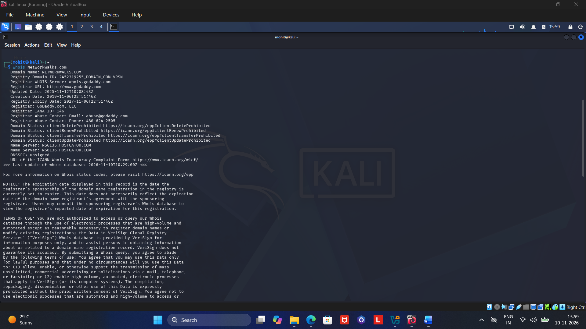

# Week 02 – Footprinting & Network Scanning


## Author

**MOHIT KUMAR**  
Cybersecurity Intern – Networkwalks  
Batch: **B084-Networkwalks**  
Program: **Cybersecurity & Ethical Hacking**  
Week: **02**  
LinkedIn: [Mohit Kumar](https://www.linkedin.com/in/mohit-kumar-992b88384/)

---

## Project Overview

This repository contains evidence from Week 02 practical activities covering:

1. **Footprinting and reconnaissance** of `networkwalks.com` using Kali Linux tools.
2. **Network discovery and topology visualization** using Zenmap on a local lab network.

The activities focus on information gathering and host discovery. The observations documented here are not, by themselves, proof of security vulnerabilities.

> **Authorization:** Domain testing was performed under the written permission stated in the project report. Zenmap activity was performed on the author's own local lab network. Only test systems for which permission has been granted should be assessed.

## Objectives

- Retrieve publicly available domain registration information.
- Identify website technologies and HTTP response information.
- Resolve domain names and enumerate DNS records.
- Identify whether a web application firewall is detected.
- Discover responding hosts on an authorized local network.
- Review network scan output and topology visualization.
- Document evidence and potential security considerations.

## Tools Used

| Tool | Purpose |
|---|---|
| Kali Linux | Reconnaissance environment |
| `whois` | Domain registration and name-server information |
| `whatweb` | Website technology fingerprinting |
| `nslookup` | DNS name resolution |
| `curl -I` | HTTP response-header inspection |
| `wafw00f` | Web Application Firewall detection |
| `dnsrecon` | DNS record enumeration |
| Zenmap / Nmap | Local network discovery and topology visualization |
| Windows CMD | Local network configuration checks |

---

## Phase 1 – Footprinting & Reconnaissance

**Target domain:** `networkwalks.com`

### 1. WHOIS lookup

```bash
whois networkwalks.com
```

Used to review publicly available registration details, registrar information, registration dates, and name servers.

**Evidence**



### 2. Additional WHOIS output

The second capture records further WHOIS information returned by the lookup.

**Evidence**


### 3. Website technology fingerprinting with WhatWeb

```bash
whatweb networkwalks.com
```

Used to identify technologies and metadata exposed by the website. The captured output reports WordPress and other detected components. Technology detection is indicative and should be verified before drawing conclusions about exact versions.

**Evidence**


### 4. DNS resolution with Nslookup

```bash
nslookup networkwalks.com
```

The captured result resolves `networkwalks.com` to `192.232.216.135`.

**Evidence**


### 5. HTTP response headers with cURL

```bash
curl -I https://networkwalks.com
```

The captured response shows an HTTP `200` status and response-header information. The presence of `/wp-json/` in a response link is not automatically a vulnerability.

**Evidence**


### 6. WAF detection with Wafw00f

```bash
wafw00f networkwalks.com
```

The captured Wafw00f output identifies ModSecurity (SpiderLabs). Detection does not establish how effectively the WAF blocks attacks.

**Evidence**


### 7. DNS enumeration with DNSRecon

```bash
dnsrecon -d networkwalks.com
```

Used to enumerate DNS information such as name servers, mail-related records, TXT records, and service records. The screenshot shows the enumeration output.

**Evidence**


---

## Phase 2 – Local Network Scanning with Zenmap

Zenmap (the Nmap graphical interface) was used for network discovery on the author's local lab network.

The workflow included:

1. Checking the local network configuration in Windows.
2. Entering the authorized local subnet in Zenmap.
3. Running the selected discovery scan.
4. Reviewing responding hosts and available address information.
5. Opening the Topology view to visualize the scan results.

### 8. Zenmap network scan

The screenshot below is the network-scan evidence extracted from the submitted Word report.


### 9. Zenmap topology

The screenshot below is the topology evidence extracted from the submitted Word report.


**Reporting note:** The report text contains example `10.0.0.x` host addresses, while the Zenmap evidence appears to show a different `192.168.56.x` lab range. Confirm the exact target subnet and host results from the original Zenmap scan before reporting specific addresses or host counts. Do not treat example addresses as actual findings.

---

## Summary of Observations

| Activity | Observation recorded |
|---|---|
| WHOIS | Registration and name-server information was retrieved |
| WhatWeb | Website technology information was detected |
| Nslookup | Domain resolved to `192.232.216.135` |
| cURL | HTTP `200` response and response headers were observed |
| Wafw00f | ModSecurity (SpiderLabs) was detected |
| DNSRecon | DNS, mail, TXT, and service-related records were enumerated |
| Zenmap | A local network discovery scan and topology view were captured |

These are reconnaissance and discovery observations. No exploitation or vulnerability validation is claimed in this project.

## Recommendations

- Keep CMS platforms, themes, and plugins updated.
- Review which technology details are unnecessarily exposed publicly.
- Review HTTP response headers and apply suitable security headers where appropriate.
- Periodically review public DNS records.
- Keep WAF rules updated and monitor their alerts.
- Regularly inventory devices on internal networks.
- Investigate unknown devices and maintain current network documentation.
- Perform security testing only within an explicitly authorized scope.

## Repository Structure

```text
Week-02-Penetration-Testing/
├── README.md
└── screenshots/
    ├── Screenshot 1.png
    ├── Screenshot 2.png
    ├── Screenshot 3.png
    ├── Screenshot 4.png
    ├── Screenshot 5.png
    ├── Screenshot 6.png
    ├── Screenshot 7.png
    ├── Screenshot 8.png
    └── Screenshot 9.png
```

## Disclaimer

This repository is for educational and authorized cybersecurity learning. Do not scan, enumerate, or test systems unless you own them or have explicit permission from the system owner. The findings are limited to the evidence captured during these practical exercises.

---

**MOHIT KUMAR**  
Cybersecurity Intern | Networkwalks | Week 02
